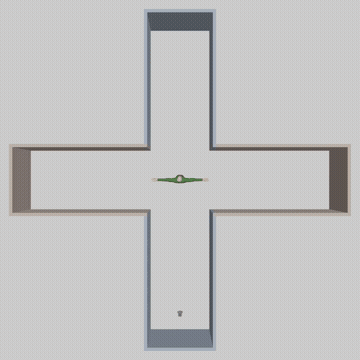

# SPITE test environents for added temporal dimension

A collection of testing environments. The following scenarios will be added:
1. Perpendicular hallways: robot moving at max velocity would be forced to intersect, forcing replanning
2. Crowd of obstacles moving in on direction, requires weaving
3. Dynamic obstacle that doesn’t interfere planning: overhead for considering dynamic obstacle when it doesn’t interfere with planning
4. Undefined geometry obstacle changes direction/velocity during trajectory to test prediction
5. And more as needed

## Perpendicular hallways with collision
A robot moving at max speed to arrive at a target location would intersect with a moving actor. In this scenario, the turtlebot should be forced to make replanning decisions, such as slowing down or moving around.

